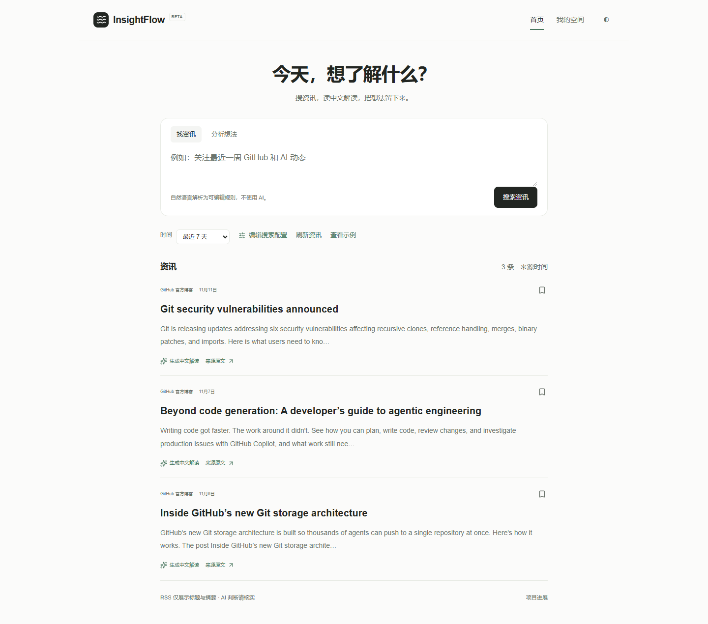

# InsightFlow

Read the news. Understand it in Chinese. Keep your own ideas.

A minimal, self-hostable RSS reader built with Next.js, React, TypeScript, Tailwind CSS and Supabase. Two main workspaces: **Home** and **My Space**. The interface is currently in Chinese.

[简体中文](README_zh-CN.md) · [Contributing](CONTRIBUTING.md) · [Development](docs/DEVELOPMENT.md) · [Deployment plan](docs/DEPLOYMENT.md)



## What works

- Browse real official RSS titles and excerpts without registering. Open the source to read the full article.
- Describe a topic in natural language, edit the parsed keyword rules, and filter by time.
- Sign in to save bookmarks, topics, preferences, ideas and analysis history. Supabase RLS isolates each account.
- Request a Chinese explanation or Idea analysis with a server-configured OpenAI-compatible provider. Keys and quotas stay on the server. **Real AI requires login** to protect the deployment's budget.
- No key? The interface explicitly says **AI 未配置**. Fixed examples are labeled and are never mixed into real results.

Only the **GitHub official blog RSS** is currently supported. This is not an AI news search engine covering the entire web. Explanations use titles and excerpts, not full-text translation.

## Try the interface without a database

Requires Node.js 24.5+ and pnpm 11.25.0.

```bash
pnpm install --frozen-lockfile
pnpm dev
```

Open `http://localhost:3000/demo`. It contains labeled fixed examples, needs no account or API key, and makes no model requests. The real feed on `/` needs Supabase configured.

**Public hosted URL: not deployed. Source code is public; run locally using the steps below.** Localhost links are not public URLs.

## Run the full app locally

Start Docker Desktop (Linux containers) or Docker Engine with Compose v2:

```bash
pnpm install --frozen-lockfile
pnpm db:start
pnpm db:migrate
pnpm dev
```

Open `http://localhost:3000`. Registration messages are captured by local Mailpit at `http://localhost:54324`; they are not delivered to your real inbox. Windows can use `pnpm.cmd`. After the first successful setup, `Start-InsightFlow.cmd` starts the local production app.

The setup generates ignored `.env.local` and `local/runtime.env`, preserves existing keys/data, and generates private local database credentials. Never delete the Docker volume to troubleshoot. Use `pnpm db:backup` before major maintenance.

## Optional real AI

In the generated **local** `.env.local`, fill `AI_BASE_URL`, `AI_MODEL` and `AI_API_KEY`, then restart the app. For DeepSeek, use its API base URL and a model enabled for your account. `.env.example` documents the variables. Provider charges are separate from application quotas; leave the key blank for a no-model deployment. Never send keys in Issues or prefix secrets with `NEXT_PUBLIC_`.

Public deployments need a hosted Supabase project, exact Auth redirect URLs, and production SMTP for the current email registration flow. OAuth is not implemented in this milestone. The local Docker stack is not a public production configuration. See [deployment](docs/DEPLOYMENT.md).

## Checks

```bash
pnpm test
pnpm typecheck
pnpm lint
pnpm build
python scripts/check-source-secrets.py --history --build
```

Database, isolation and browser checks are documented in [Development](docs/DEVELOPMENT.md). The V0.1 local report is in [TEST-V0.1.md](docs/TEST-V0.1.md). AI regression fixtures do not spend real API credits. Prepared GitHub Actions have not yet run on GitHub.

## Scope and contribution

No payments, automatic push, scheduled collection or complex agents are implemented. Mobile sizes are tested with Chromium emulation, not physical iOS Safari. Free hosting capacity and mainland China access have not been measured in a deployed environment.

Please share specific reading problems or official sources you would like to follow. If the project helps you, a Star and a reproducible issue help us choose the next improvement. Updates: [@00LOX](https://github.com/00LOX).

The inherited [MIT LICENSE](LICENSE) is unchanged. The [dependency report and alternatives](docs/LICENSE-AUDIT.md) explain obligations. Third-party components and RSS content retain their own rights. See [notices](THIRD_PARTY_NOTICES.md).
