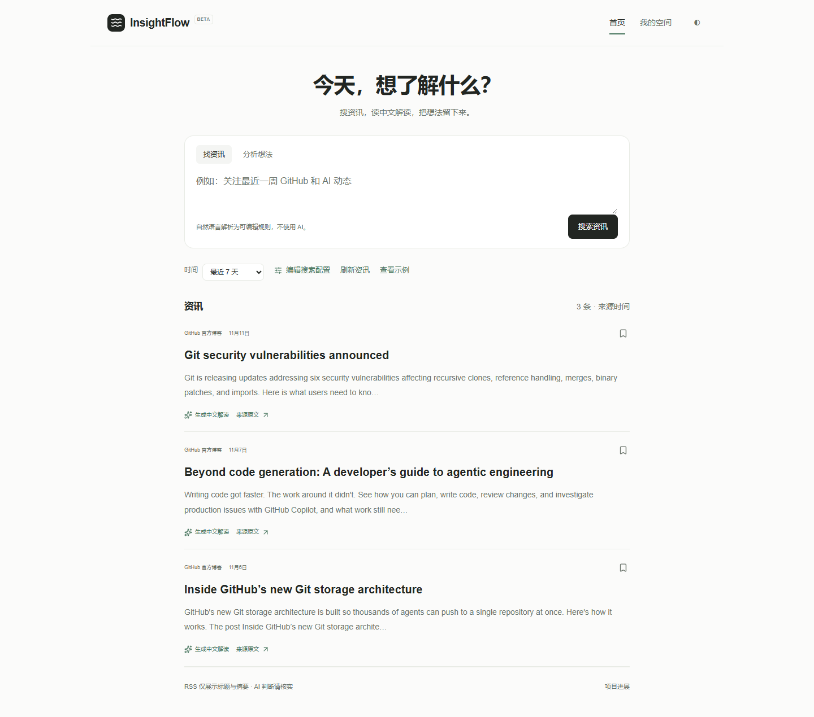

# InsightFlow

读懂资讯，留下自己的想法。一个极简、可自部署的 RSS 阅读工具。

[English](README.md) · [开发说明](docs/DEVELOPMENT.md) · [参与贡献](CONTRIBUTING.md) · [部署方案](docs/DEPLOYMENT.md)



## 两个工作区

- **首页**：不注册也能浏览真实 RSS；用自然语言输入主题，编辑关键词、排除词和时间配置，打开来源原文。登录后可收藏、生成中文解读、保存并分析想法。
- **我的空间**：收藏、关注主题、想法、历史、账号与基础配置。Supabase RLS 保留账户隔离，原有有价值的功能继续保留。

真实 AI 要求登录，由服务端保护 Key 和额度。无 Key 明确显示 **AI 未配置**，不伪造结果；固定内容标注“示例”。

目前只有 **GitHub 官方博客 RSS**，并未覆盖全网资讯。页面只提供标题、有限摘要和来源链接，中文解读基于 RSS 摘要，不是全文翻译。

## 先看示例

需要 Node.js 24.5+、pnpm 11.25.0。Windows 可用 `pnpm.cmd`。

```bash
pnpm install --frozen-lockfile
pnpm dev
```

访问 `http://localhost:3000/demo`。示例不需要数据库、账号或 Key，不调用模型。首页真实资讯需要配置 Supabase。

**应用公开网址尚未上线；GitHub 仅提供源码。localhost 只在本机访问。**

## 完整本地运行

先启动 Docker Desktop（Linux containers）或 Docker Engine + Compose v2：

```bash
pnpm install --frozen-lockfile
pnpm db:start
pnpm db:migrate
pnpm dev
```

访问 `http://localhost:3000`。注册确认邮件在本地 `http://localhost:54324`，不会投递到真实邮箱。后续 Windows 可双击 `Start-InsightFlow.cmd`。

初始化生成被忽略的 `.env.local`、`local/runtime.env` 和随机本地数据库凭据，保留已有非空配置与用户数据。维护前用 `pnpm db:backup` 备份，不要通过删除数据卷排错。

## 接入真实 AI

在生成的本机 `.env.local` 填写 `AI_BASE_URL`、`AI_MODEL`、`AI_API_KEY`，保存并重启。支持 OpenAI 兼容接口，包括 DeepSeek。模型名称以自己的服务商账号实际可用为准。不要把 Key 发到聊天或 Issue，不要给服务端密钥加 `NEXT_PUBLIC_`。

无 Key 仍可阅读、收藏和记录想法。应用内额度与服务商账单分开；未配置单价时费用显示未知。公开服务可先保持无 Key，再受控接入真实分析。

## 验证与边界

```bash
pnpm test
pnpm typecheck
pnpm lint
pnpm build
python scripts/check-source-secrets.py --history --build
```

数据库、双账号隔离、安全和浏览器检查见 [开发说明](docs/DEVELOPMENT.md)，本轮结果见 [V0.1 测试报告](docs/TEST-V0.1.md)。AI 回归使用明确模拟夹具，不消耗真实模型额度。CI 已配置，尚未在 GitHub 执行。

本轮没有收费、自动推送、定时采集或复杂 Agent。手机和平板是 Chromium 尺寸仿真，尚未验证真实 iOS Safari。当前邮箱注册需正式 SMTP；OAuth 入口尚未实现。免费托管的容量和中国大陆访问速度须部署后实测。

## 参与

欢迎反馈哪里看不懂、哪里步骤太多，以及希望跟进的官方来源。如果项目有用，欢迎 Star；关注 [@00LOX](https://github.com/00LOX) 查看进展。

仓库原有 [MIT LICENSE](LICENSE) 本轮未改写；源码公开时沿用原有协议。参见 [依赖审计与 MIT / Apache / AGPL 取舍](docs/LICENSE-AUDIT.md)、[第三方声明](THIRD_PARTY_NOTICES.md)。RSS 内容仍归原作者所有。
